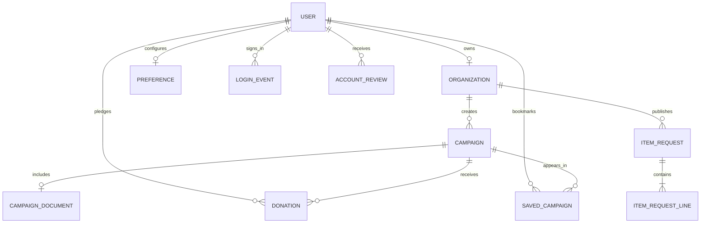

# Milestone 2 database

SQLite file: `db.sqlite3`. Apply migrations from `../backend` with `.\.venv\Scripts\python.exe manage.py migrate`.

| Table | Stored information |
| --- | --- |
| `donations_user` | Unique normalized email, hashed password, role, donor/contact profile, interests, active flag, approval status/note/reviewer/time, access version, signup/last-login/consent timestamps |
| `donations_accountreview` | Account, administrator, approval/access action, reason, and timestamp |
| `donations_organization` | One NGO per user, unique registration number, mission, website, verification/reviewer details |
| `donations_itemrequest` | NGO-owned request title, NGO delivery address/city/state/pincode, optional date/notes, Open/Closed status, version and timestamps |
| `donations_itemrequestline` | Request, canonical donation item key, positive decimal quantity; one row per distinct item |
| `donations_itemdonation` | Donor offer, catalog item, quantity, full pickup address/city/state/PIN, notes/photo, submission ID, edit version and timestamp |
| `donations_donationmatch` | Reserved quantity, donor/request relationship, pickup details, delivery proof, status and version |
| `donations_matchevent` | Timestamped match, pickup, cancellation and receipt history |
| `donations_notification` | Private account notifications and read state |
| `donations_campaign` | NGO-owned campaigns, target/raised amounts, category, dates, status, image, reviewer details |
| `donations_campaigndocument` | Optional private supporting document for a campaign |
| `donations_donation` | Donor, campaign, amount, anonymity, message, timestamp, unique per-donor transaction reference |
| `donations_savedcampaign` | Unique donor/campaign bookmarks |
| `donations_preference` | One set of dashboard and pledge preferences per account |
| `donations_contactmessage` | Contact form inbox visible to administrators |
| `donations_activity` | Registration/campaign/review activity and resolution status |
| `donations_loginevent` | Login email, role, success/failure, timestamp; no submitted passwords |
| `django_session` | Server-side authenticated sessions and expiry |

Django also maintains migration, permission, group, content-type, and admin-log tables. The generated [schema.sql](schema.sql) describes the application's tables; migrations are the authoritative schema and include prerequisites.

Database constraints enforce case-insensitive unique emails, unique NGO registration numbers, unique bookmarks, unique donation references per donor, positive targets/pledges, nonnegative campaign totals, and valid campaign date ranges. Pledge creation and funding updates run in a single transaction.

Migration `0003_item_requests` adds item requests and lines. Each request has a unique item key per line and a quantity greater than zero and at most 1,000,000. The API validates the canonical item catalog, fixed units, whole-number rules, and delivery fields. Request creation and replacement of item lines are atomic; version checks protect against stale edits. The catalog lives in `backend/donations/donation_items.py` and is returned through the state API.

Inspect records through Django admin at `http://127.0.0.1:8000/admin/` after creating a superuser. Database files are ignored by Git; preserve the file to retain accounts and records. Clearing browser storage does not delete database records.

Migrations `0006_item_donation_pickup_address` and `0007_itemdonation_version` add full pickup addresses and optimistic edit versions to donor offers. Existing records are preserved with blank address fields. New offers require a complete address at the API boundary. Offers and NGO requests can be deleted only before they have match history; foreign-key protection also preserves historical matches. AI suggestions are not separate database records and do not change saved donations until the donor saves the reviewed form.
