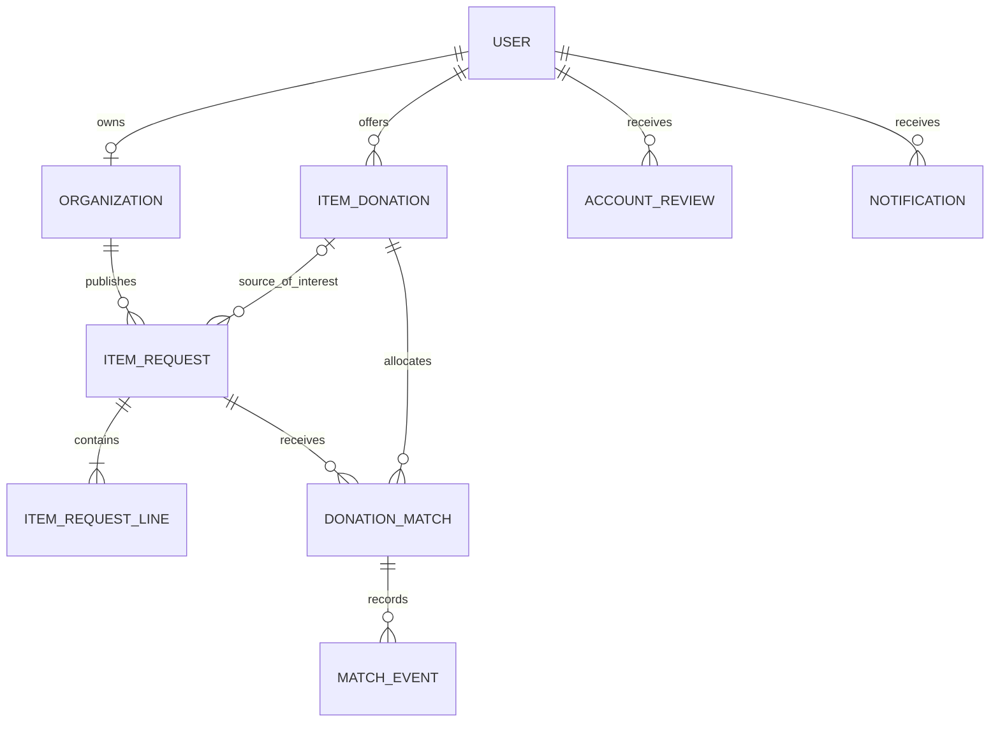

# Database

The local database is `db/db.sqlite3`. Django migrations in [backend/donations/migrations](../backend/donations/migrations) define the authoritative schema. Apply them from `backend`:

```powershell
.\.venv\Scripts\python.exe manage.py migrate
```

`DJANGO_DB_PATH` can select a different SQLite file. Database files and credentials are excluded from Git. A new clone starts without accounts or donation records; create an administrator with `manage.py createsuperuser`.

## Core tables

| Table | Purpose |
| --- | --- |
| `donations_user` | Email identity, password hash, role, contact details, approval state and access version. |
| `donations_organization` | NGO profile, registration number and verification state; one per NGO user. |
| `donations_accountreview` | Administrator account decisions, reasons and timestamps. |
| `donations_itemrequest` | NGO request, contact/location, priority, status and version; optional source donation for expressed interest. |
| `donations_itemrequestline` | Catalog item, requested quantity and fulfilled quantity for a request. |
| `donations_itemdonation` | Donor offer, catalog item, quantity, pickup address, photo, submission UUID and edit version. |
| `donations_donationmatch` | Reserved quantity connecting offer and request, pickup details, receipt proof/check, status and version. |
| `donations_matchevent` | Timestamped matching, pickup, receipt and cancellation events. |
| `donations_notification` | Account-specific notifications and read state. |
| `donations_loginevent` | Login outcome, account/email, role and time; no submitted passwords. |
| `donations_preference` | Account preferences. |
| `donations_contactmessage` | Contact form messages. |
| `donations_activity` | Administrative activity and resolution state. |
| `django_session` | Server-managed sessions and expiry. |

Campaign, campaign-document, pledge (`donations_donation`) and saved-campaign tables are retained for compatibility. They are distinct from physical item offers and matches. Django also creates permission, group, content-type, migration and administrator-log tables.

## Item-donation relationships



## Integrity rules

- Emails are unique case-insensitively; NGO registration numbers are unique.
- A request contains at most one line per catalog item.
- New API quantities must be positive whole numbers, at most 1,000,000. Decimal database columns preserve historical values.
- Received quantities cannot exceed requested quantities. Active matches reserve the remaining capacity on both the offer and the request.
- Donor submission UUIDs provide idempotency. NGO/source-donation uniqueness prevents duplicate interest requests.
- At most one non-cancelled match exists for a given offer/request pair.
- Version checks prevent stale edits. Reservation and receipt updates run in transactions.
- Protected relations preserve delivery history. Eligible unused offers/requests may be deleted; records with match history cannot be removed through the normal API.

## Schema reference

[schema.sql](schema.sql) contains application table/index definitions generated from a fresh database after migration `0009_itemrequest_source_donation_and_more`. It contains no user records. It is a reference, not an installation script; use Django migrations so framework tables and migration history are also created correctly.

Migration 0008 adds receipt comparison fields. Migration 0009 links an interest request to its source donation and adds the organization/source uniqueness constraint. Apply all migrations rather than selecting an individual migration from older setup notes.

## Maintenance

Inspect authorized records through Django admin at http://127.0.0.1:8000/admin/. Use the application/API for normal matching and receipt updates so quantity and workflow checks run consistently.

Back up the SQLite database before deployment or schema changes, using a consistent SQLite backup or by stopping writers during the copy. Preserve the database to retain records; clearing browser storage does not remove them. Never upload a populated database, session data or secret files to a repository.
